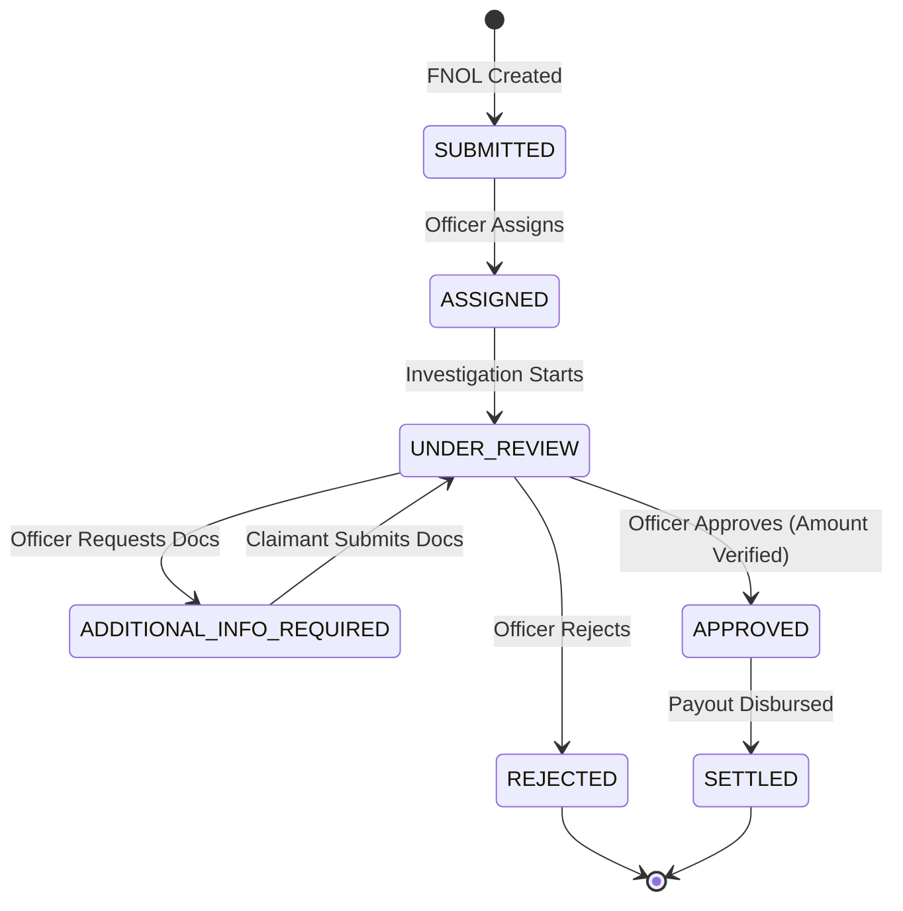

# Chubb APAC Claims Management Platform

[](https://adoptium.net)
[](https://spring.io/projects/spring-boot)
[](https://angular.dev)
[](https://www.docker.com)
[]()

> **Chubb APAC Engineering — Take-Home Assessment (Fullstack Developer)**  
> A production-ready, event-driven insurance claims platform handling **Motor and Property** claims across six APAC markets: **Singapore, Hong Kong, Australia, Thailand, Malaysia, and Indonesia**.

---

## Table of Contents
1. [Overview & Problem Statement](#overview--problem-statement)
2. [Architecture & System Design](#architecture--system-design)
3. [Quickstart: Run in Under 5 Minutes](#quickstart-run-in-under-5-minutes)
4. [API Contract & Swagger Documentation](#api-contract--swagger-documentation)
5. [Automated Testing & Coverage](#automated-testing--coverage)
6. [Demo Credentials & Persona Walkthrough](#demo-credentials--persona-walkthrough)
7. [Repository Structure](#repository-structure)
8. [AI Working Journal & Prompt Log](#ai-working-journal--prompt-log)

---

## Overview & Problem Statement
Chubb APAC processes thousands of insurance claims across six regional markets. Historically, claimants submitted details via phone or email without status visibility, claims staff juggled spreadsheets and shared inboxes, and regional managers lacked real-time visibility into outstanding liability exposure.

This platform unifies the entire claims lifecycle in a single platform:
- **Claimants:** File First Notice of Loss (FNOL), track progress via a visual status tracker, provide additional requested documentation, and receive payouts.
- **Claims Officers:** Pick up claims from a centralized workload queue, review damage descriptions, request clarification, and render approve/reject decisions.
- **Regional Managers:** Monitor real-time **Outstanding Liability Exposure** broken down by market jurisdiction and portfolio type.

---

## Architecture & System Design

### Feature-Oriented Modular Monolith Blueprint
The backend is structured as a **Feature-Oriented Modular Monolith** using Spring Boot 3.2.5 and Java 21, enforcing strict domain boundaries:

```
src/main/java/com/chubb/claims/
├── auth/          # Identity, JWT issuance, User entity, Login/Profile APIs
├── claim/         # Claims lifecycle, FNOL, 7-step state machine, assessment
├── dashboard/     # Statutory multi-currency liability calculation & KPIs
├── notification/  # In-process Spring events & Apache Kafka publishers
├── security/      # Stateless JWT filters, Spring Security 6 RBAC
└── shared/        # OpenAPI config, demo data initializer, GlobalExceptionHandler
```

### Claim Lifecycle State Machine
Every claim strictly adheres to the state transitions defined below. Illegal jumps (e.g. `SUBMITTED` directly to `SETTLED`) are rejected with `HTTP 400 Bad Request`.



### Communication: Synchronous REST vs Asynchronous Kafka
- **Synchronous REST / HTTP:** Used for user interactions requiring deterministic verification (Login, Submit FNOL, Assign, Assess, Settle).
- **Asynchronous Apache Kafka:** Used for decoupled domain events (`ClaimCreatedEvent`, `ClaimStatusChangedEvent`, `ClaimSettledEvent`) triggering notifications, audit logs, and downstream accounting integrations.

---

## Quickstart: Run in Under 5 Minutes

### Option A: One-Command Docker Setup (PostgreSQL + Kafka + Backend + Frontend)
Requires Docker & Docker Compose:

```bash
docker compose up --build
```

- **Angular Frontend:** [http://localhost:4200](http://localhost:4200)
- **Spring Boot Backend:** [http://localhost:8080](http://localhost:8080)
- **Swagger UI:** [http://localhost:8080/swagger-ui.html](http://localhost:8080/swagger-ui.html)
- **PostgreSQL Database:** `localhost:5432` (`chubb_admin` / `ChubbSecure2026!`)

---

### Option B: Zero-Dependency Local Dev Setup (H2 Database)
If you prefer running without Docker, the default `dev` profile utilizes an in-memory H2 database and in-memory event bus:

#### 1. Start Backend:
```bash
cd backend
mvn spring-boot:run
```
*(Backend starts on `http://localhost:8080` in ~5 seconds).*

#### 2. Start Frontend:
```bash
cd frontend
npm install
npm start
```
*(Frontend starts on `http://localhost:4200`).*

---

## API Contract & Swagger Documentation
- **Interactive Swagger UI:** [http://localhost:8080/swagger-ui.html](http://localhost:8080/swagger-ui.html)
- **OpenAPI 3.0 Specification:** `openapi/claims-api.yaml`
- **Postman Collection:** `postman/chubb-claims.postman_collection.json`

### Key Endpoints
| HTTP Method | Endpoint | Description | Permitted Roles |
| :--- | :--- | :--- | :--- |
| `POST` | `/api/v1/auth/login` | Authenticate user & receive JWT | Public |
| `POST` | `/api/v1/claims` | Submit new FNOL claim | `CLAIMANT`, `OFFICER` |
| `GET` | `/api/v1/claims` | List/filter claims by status/market | All Authenticated |
| `GET` | `/api/v1/claims/{id}` | Detailed claim view & audit trail | All Authenticated |
| `POST` | `/api/v1/claims/{id}/assign` | Assign claim to adjuster | `CLAIMS_OFFICER` |
| `POST` | `/api/v1/claims/{id}/review` | Start claim investigation | `CLAIMS_OFFICER` |
| `POST` | `/api/v1/claims/{id}/request-info`| Request documents from claimant | `CLAIMS_OFFICER` |
| `POST` | `/api/v1/claims/{id}/submit-info` | Claimant provides info | `CLAIMANT` |
| `POST` | `/api/v1/claims/{id}/assess` | Approve or Reject claim | `CLAIMS_OFFICER` |
| `POST` | `/api/v1/claims/{id}/settle` | Finalize financial disbursement | `CLAIMS_OFFICER` |
| `GET` | `/api/v1/dashboard/metrics` | Workload & claims KPI counts | `OFFICER`, `MANAGER` |
| `GET` | `/api/v1/dashboard/liability` | Outstanding liability across 6 markets | `OFFICER`, `MANAGER` |

---

## Automated Testing & Coverage

Run the automated JUnit 5 & MockMvc test suite with:

```bash
cd backend
mvn test
```

### Covered Test Scenarios
- ✅ **ClaimStateMachineTest:** Validates all 7 allowed transitions; rigorously asserts that illegal jumps (e.g. `SUBMITTED -> SETTLED`) throw `InvalidStateTransitionException`.
- ✅ **ClaimServiceTest:** Verifies FNOL creation, claim assignment, approved amount validation, and event emission.
- ✅ **DashboardServiceTest:** Verifies statutory currency liability exposure calculation across all 6 APAC jurisdictions.
- ✅ **ClaimConcurrencyAndSecurityTest:** Verifies optimistic locking (`@Version`) race conditions, cross-tenant claimant data isolation, and officer jurisdiction enforcement.
- ✅ **ClaimControllerIntegrationTest:** MockMvc integration test validating HTTP status codes, validation constraints (`400 Bad Request`), and JWT security authorization.

---

## Demo Credentials & Persona Walkthrough

Use the **Global Role Switcher** at the top of the Angular application or log in via API with `password123`:

| Role | Name | Email | Jurisdiction | Features Available |
| :--- | :--- | :--- | :--- | :--- |
| **Claimant** | Tan Wei Ling | `claimant.sg@gmail.com` | Singapore | Submit FNOL, Track claim timeline, Submit requested documents |
| **Claims Officer** | Sarah Jenkins | `officer@chubb.com` | Singapore | Workload Queue, Assign to self, Review, Request info, Assess, Settle |
| **Claims Manager** | Marcus Vance | `manager@chubb.com` | Singapore | 6-Market Statutory Currency Liability Dashboard, Workload KPIs |

---

## Repository Structure

```
chubb-claims-platform/
├── README.md                      # Comprehensive developer guide & system architecture
├── NOTES.md                       # Technical decisions, assumptions & trade-off analysis
├── AI_WORKING_JOURNAL.md          # Candidate AI interaction journal (as requested by Chubb)
├── .env.example                   # Environment variable template
├── docker-compose.yml             # Single-command local environment setup
├── .gitignore                     # Professional git exclusions
│
├── backend/
│   ├── src/main/java/com/chubb/claims/
│   │   ├── auth/                  # Identity, JWT issuance, User entity, Login/Profile APIs
│   │   ├── claim/                 # Claims lifecycle, FNOL, 7-step state machine, assessment
│   │   ├── dashboard/             # Statutory multi-currency liability calculation & KPIs
│   │   ├── notification/          # In-process Spring events & Apache Kafka publishers
│   │   ├── security/              # Stateless JWT filters, Spring Security 6 RBAC
│   │   └── shared/                # OpenAPI config, demo data initializer, GlobalExceptionHandler
│   ├── src/main/resources/
│   │   ├── application.yml        # Dual profile: dev (H2) & docker (PostgreSQL + Kafka)
│   │   └── db/migration/          # Initial SQL schema DDL & seed data
│   ├── src/test/java/com/chubb/claims/ # Automated JUnit 5 & MockMvc test suite
│   ├── Dockerfile                 # Java 21 multi-stage build
│   └── pom.xml                    # Spring Boot 3.2.5 + Java 21
│
├── frontend/
│   ├── src/app/
│   │   ├── core/models/           # Claim, MarketLiability TypeScript interfaces
│   │   ├── features/
│   │   │   ├── claimant/          # FNOL form, active claims list, visual progress tracker
│   │   │   ├── officer/           # Workload queue, market/status filters, assessment modal
│   │   │   └── manager/           # 6 APAC markets statutory currency liability dashboard
│   │   ├── shared/services/       # Claims API client with explicit Demo Mode toggle
│   │   ├── app.component.ts       # Global persona switcher & layout controller
│   │   ├── app.component.html     # App shell delegating to feature components
│   │   └── app.component.css      # Chubb APAC enterprise theme styling
│   ├── Dockerfile
│   └── package.json
│
├── openapi/
│   └── claims-api.yaml            # OpenAPI 3.0 API Contract definition
│
├── postman/
│   └── chubb-claims.postman_collection.json # Complete Postman test collection
│
├── prompts/                       # LLM Prompt history log (10 prompts)
│   ├── 01-architecture-and-domain.md
│   ├── 02-database-design-and-lifecycle.md
│   ├── 03-api-contract-and-openapi.md
│   ├── 04-backend-implementation.md
│   ├── 05-security-and-jwt.md
│   ├── 06-kafka-and-event-processing.md
│   ├── 07-automated-testing.md
│   ├── 08-angular-implementation.md
│   ├── 09-docker-and-local-setup.md
│   └── 10-final-review.md
│
└── docs/
    ├── ARCHITECTURE.md            # C4 component & sequence diagrams
    ├── WALKTHROUGH.md             # 15-20 min hiring panel presentation & defense guide
    ├── ER_DIAGRAM.md              # Complete relational entity relationship documentation
    └── DESIGN_DECISIONS.md        # Formal Architecture Decision Records (ADR 01-06)
```

---

## AI Working Journal & Prompt Log
As explicitly requested by Chubb APAC Engineering:
- Detailed records of prompts, accepted recommendations, challenges, and overrides are documented in [AI_WORKING_JOURNAL.md](AI_WORKING_JOURNAL.md) and [.antigravity/ai-journal.md](.antigravity/ai-journal.md).
- Individual stage prompts are tracked in [`prompts/`](prompts/).
