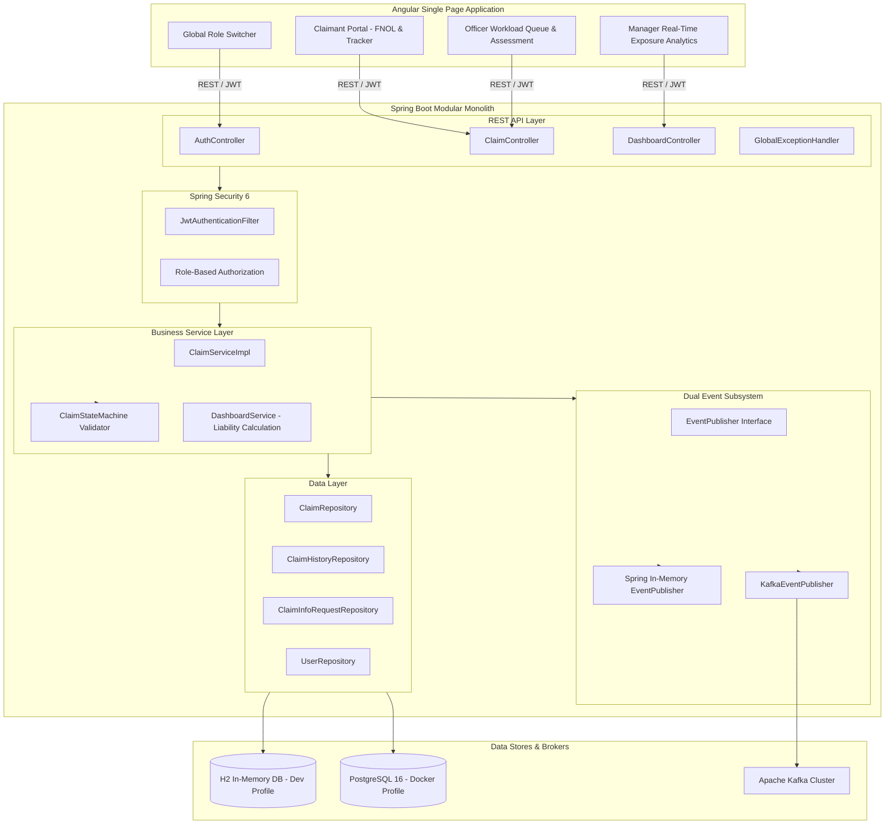
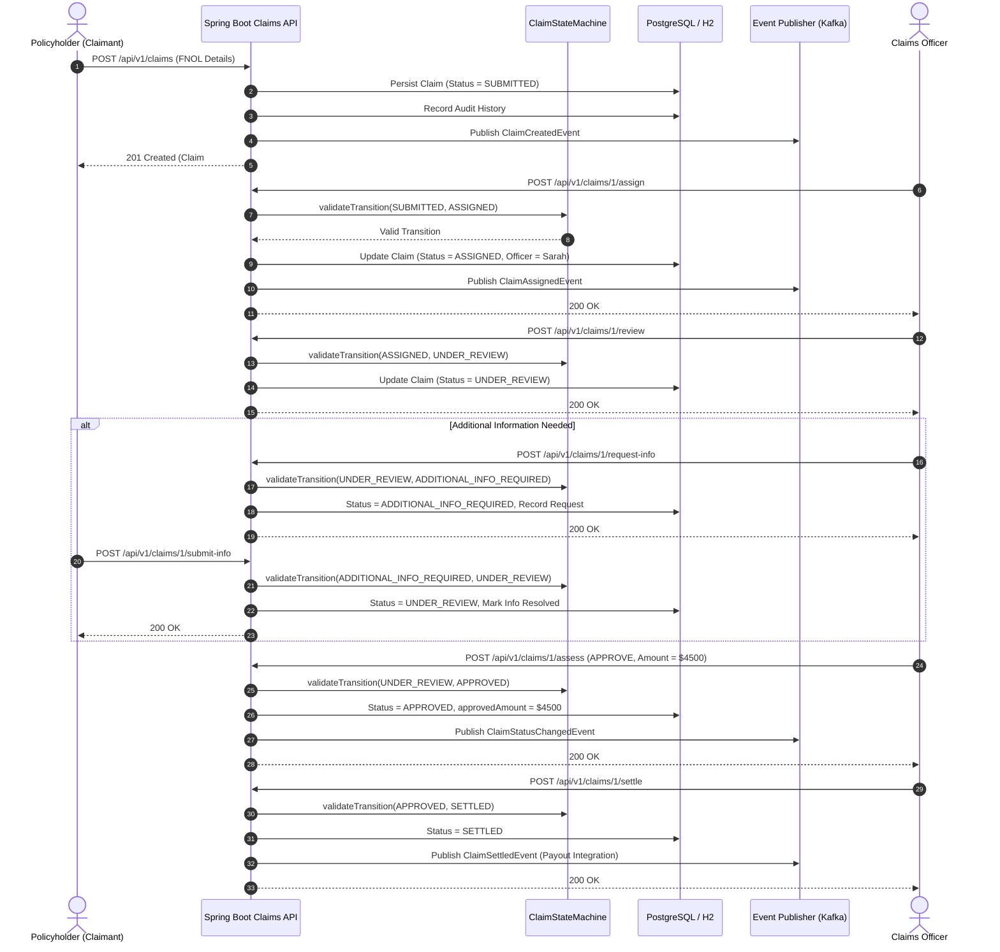

# Chubb APAC Claims Platform - Architecture & Design Document

## 1. System Overview
The Chubb APAC Claims Platform is a high-performance, modular insurance processing engine designed for motor and property portfolios across six Asia-Pacific markets: **Singapore, Hong Kong, Australia, Thailand, Malaysia, and Indonesia**.

---

## 2. Claim Lifecycle Sequence Diagram
The state machine strictly validates all transitions according to Chubb APAC insurance underwriting guidelines:

---

## 3. Communication Strategy: REST vs Kafka Deep-Dive

| Interaction Pattern | Protocol | Use Case | Architectural Justification |
| :--- | :--- | :--- | :--- |
| **Synchronous Command** | REST / JSON | User Login, FNOL Claim Submission, Self-Assignment | Requires immediate client feedback, HTTP status codes, and atomic validation before continuing. |
| **Synchronous Query** | REST / JSON | View Claim Detail, Outstanding Liability Metrics | High-frequency, immediate read operations required for interactive UI dashboards. |
| **Asynchronous Event** | Apache Kafka | `ClaimCreatedEvent`, `ClaimStatusChangedEvent` | Decouples long-running side-effects (fraud detection scoring, customer SMS/email notifications, data warehouse analytics). |
| **Financial Disbursement** | Apache Kafka | `ClaimSettledEvent` | Triggers downstream financial ledger and core banking payout systems with guaranteed delivery. |

---

## 4. Multi-Market Exposure Aggregation Formula
The executive dashboard calculates real-time liability exposure by aggregating active claim amounts across all 6 markets:

$$\text{Outstanding Liability} = \sum_{c \in \text{Claims}} \begin{cases} c.\text{estimatedAmount} & \text{if } c.\text{status} \in \{\text{SUBMITTED, ASSIGNED, UNDER\_REVIEW, ADDITIONAL\_INFO\_REQUIRED}\} \\ c.\text{approvedAmount} & \text{if } c.\text{status} = \text{APPROVED} \\ 0 & \text{if } c.\text{status} \in \{\text{SETTLED, REJECTED}\} \end{cases}$$
