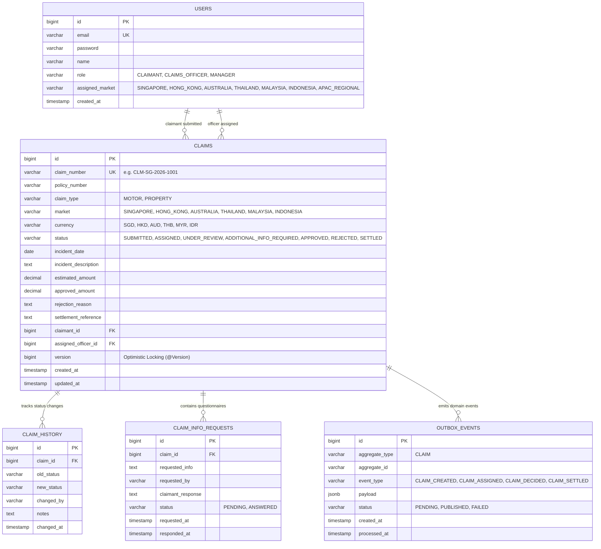

# Chubb APAC Claims Platform - Entity Relationship (ER) Diagram

## 1. Domain Data Model Overview

The database schema is engineered with relational integrity, statutory multi-currency support, auditability, and optimistic concurrency control.

---

## 2. Key Architectural Guarantees

### A. Optimistic Concurrency Control (`version`)
- The `CLAIMS.version` column maps directly to Spring Data JPA's `@Version`.
- When multiple claims adjusters attempt to take ownership of or assess an unassigned claim concurrently, Hibernate generates an `UPDATE ... WHERE id = ? AND version = ?`.
- Conflicting simultaneous updates automatically fail with `OptimisticLockException` (`409 Conflict`), preventing lost updates and duplicate assignments.

### B. Multi-Jurisdiction Currency Rigor (`market` + `currency`)
- Every claim explicitly stores its ISO 4217 statutory currency code (`SGD`, `HKD`, `AUD`, `THB`, `MYR`, `IDR`).
- Financial reserve and exposure calculations group by `(market, currency)` preventing mathematically invalid summing of different fiat currencies without spot exchange conversions.

### C. Complete Immutability & Auditability (`CLAIM_HISTORY`)
- Any transition in `CLAIMS.status` automatically generates a non-destructive audit log entry in `CLAIM_HISTORY` capturing `old_status`, `new_status`, timestamp, and identity of the actor.

### D. Transactional Outbox Pattern (`OUTBOX_EVENTS`)
- Prevents dual-write inconsistencies between the relational database transaction and external Kafka messaging brokers.
